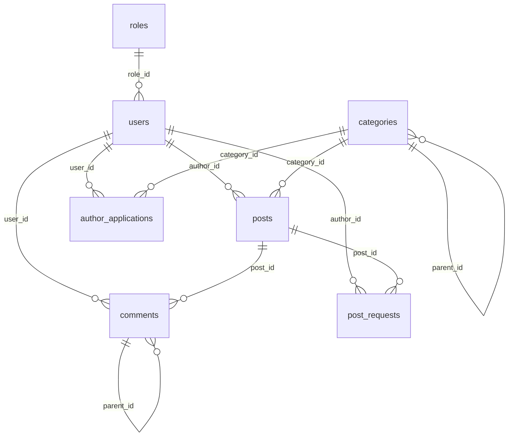

# BaoUT

Website tin tức viết bằng Laravel. Độc giả đọc và bình luận, tác giả viết bài và gửi duyệt, quản trị viên kiểm duyệt và quản lý toàn trang.

> Đây là đồ án môn học. Bài viết, số liệu, số giấy phép, hotline và địa chỉ hiển thị trên trang là **dữ liệu minh họa**, không phải của một tòa soạn có thật.

## Mục lục

- [Chức năng](#chức-năng)
- [Phân quyền](#phân-quyền)
- [Công nghệ](#công-nghệ)
- [Cài đặt](#cài-đặt)
- [Tài khoản mẫu](#tài-khoản-mẫu)
- [Email](#email)
- [Kiểm thử](#kiểm-thử)
- [Cấu trúc mã nguồn](#cấu-trúc-mã-nguồn)
- [Cơ sở dữ liệu](#cơ-sở-dữ-liệu)
- [Hạn chế đã biết](#hạn-chế-đã-biết)

## Chức năng

**Đọc tin**

- Trang chủ, danh sách tin, trang bài viết, trang tác giả.
- Chuyên mục hai cấp (cha – con); lọc theo chuyên mục, sắp xếp mới nhất hoặc xem nhiều.
- Tìm kiếm theo tiêu đề, tóm tắt và nội dung.
- In bài, chia sẻ lên Facebook, X, Zalo, sao chép liên kết.
- RSS (`/feed`, `/feed/{chuyên-mục}`), sitemap (`/sitemap.xml`) và dữ liệu cấu trúc JSON-LD.
- Đếm lượt xem: mỗi người xem chỉ tính một lần cho mỗi bài trong 24 giờ.

**Tài khoản**

- Đăng ký, xác minh email, đăng nhập, quên mật khẩu, đổi mật khẩu.
- Sửa họ tên và email. Đổi email thì phải xác minh lại.

**Bình luận**

- Bình luận và trả lời theo hai cấp; sửa, xóa bình luận của mình; xem lại ở `/my-comments`.

**Tác giả**

- Độc giả nộp đơn ứng tuyển kèm CV (PDF, DOC, DOCX, tối đa 5 MB). Được duyệt thì lên quyền tác giả.
- Soạn bài bằng Quill, tải ảnh, xem trước, lưu nháp, gửi duyệt, rút bài.
- Bài đã đăng: gửi yêu cầu gỡ bài hoặc đính chính để quản trị viên xử lý.

**Quản trị**

- Duyệt bài (có thể hẹn giờ đăng) hoặc từ chối kèm lý do; ẩn, lưu trữ, khôi phục bài.
- Xử lý yêu cầu gỡ bài và đính chính.
- Quản lý chuyên mục, bình luận, tài khoản độc giả và tác giả, đơn ứng tuyển.
- Thống kê trên bảng điều khiển; xuất danh sách bài viết và bình luận ra CSV.

## Phân quyền

| Chức năng | Khách | Độc giả | Tác giả | Quản trị |
| :--- | :---: | :---: | :---: | :---: |
| Đọc tin, tìm kiếm, RSS, gửi liên hệ | ✅ | ✅ | ✅ | ✅ |
| Bình luận (cần xác minh email) | – | ✅ | ✅ | ✅ |
| Sửa hồ sơ, đổi mật khẩu | – | ✅ | ✅ | ✅ |
| Nộp đơn ứng tuyển tác giả | – | ✅ | – | – |
| Viết bài, gửi duyệt, rút bài của mình | – | – | ✅ | ✅ |
| Yêu cầu gỡ hoặc đính chính bài đã đăng của mình | – | – | ✅ | ✅ |
| Tự xuất bản bài của mình | – | – | – | ✅ |
| Duyệt bài và quản lý toàn trang | – | – | – | ✅ |

Quản trị viên không sửa được quyền của tài khoản quản trị viên khác. Tài khoản bị khóa sẽ bị đăng xuất ở các trang cần đăng nhập.

## Công nghệ

| Phần | Dùng |
| :--- | :--- |
| Backend | PHP 8.4 trở lên, Laravel 13 |
| Giao diện | Blade, Tailwind CSS 4, JavaScript thuần viết trong Blade |
| Build | Vite 8 |
| Soạn thảo | Quill 2 (tải từ CDN) |
| Xử lý ảnh | Intervention Image 4 với GD, lưu WebP |
| Cơ sở dữ liệu | SQLite mặc định; cấu hình được MySQL |
| Kiểm thử | PHPUnit 12, Laravel Pint |
| Font | Noto Serif, JetBrains Mono (tải từ Google Fonts) |

## Cài đặt

Cần có:

- PHP 8.4 trở lên, bật `gd`, `fileinfo`, `mbstring`, `openssl` và `pdo_sqlite` (hoặc `pdo_mysql`)
- Composer 2
- Node.js 20.19 trở lên, hoặc 22.12 trở lên

```bash
git clone https://github.com/Xu4nNh4n/newshub-laravel.git
cd newshub-laravel

composer install
php -r "copy('.env.example', '.env');"
php artisan key:generate

php -r "touch('database/database.sqlite');"
php artisan migrate --seed
php artisan storage:link

npm install
npm run build

php artisan serve
```

Mở <http://localhost:8000>.

Khi sửa giao diện, chạy thêm `npm run dev` ở một cửa sổ khác. Cổng của Vite (5173) chỉ phục vụ CSS, trang web vẫn ở cổng 8000.

Dữ liệu mẫu chỉ được tạo khi `APP_ENV` là `local` hoặc `testing`. Bài mẫu không kèm ảnh, vì ảnh tải lên không nằm trong git.

### Dùng MySQL

Tạo database trống bảng mã `utf8mb4_unicode_ci`, sửa `.env` rồi chạy lại `php artisan migrate --seed`:

```env
DB_CONNECTION=mysql
DB_HOST=127.0.0.1
DB_PORT=3306
DB_DATABASE=apptintuc
DB_USERNAME=root
DB_PASSWORD=
```

File `database/sql/apptintuc_mysql.sql` là bản xuất **cũ**, chưa có bảng `roles`. Nên dùng migration thay cho file này.

## Tài khoản mẫu

Mật khẩu chung: `password`. Cả ba tài khoản đã xác minh email.

| Vai trò | Email |
| :--- | :--- |
| Quản trị viên | `admin@newshub.test` |
| Tác giả | `author@newshub.test` |
| Độc giả | `reader@newshub.test` |

Không dùng các tài khoản này trên môi trường thật.

## Email

Mặc định `MAIL_MAILER=log`: email không gửi đi mà ghi vào `storage/logs`, có thể lấy liên kết xác minh ở đó. Để gửi thật, xem [docs/EMAIL_SETUP.md](docs/EMAIL_SETUP.md).

Thư từ form liên hệ gửi về `CONTACT_MAIL_ADDRESS`; nếu để trống thì gửi về `MAIL_FROM_ADDRESS`.

## Kiểm thử

```bash
php artisan test
vendor/bin/pint --test
```

Bộ test gồm các feature test, chạy trên SQLite trong bộ nhớ nên không đụng tới dữ liệu đang có.

## Cấu trúc mã nguồn

```text
app/
├── Enums/            Vai trò, trạng thái bài viết, bình luận, chuyên mục...
├── Http/
│   ├── Controllers/  Chia theo Admin, Auth, Author và phần công khai
│   ├── Middleware/   Kiểm tra vai trò, chặn tài khoản bị khóa
│   ├── Requests/     Kiểm tra dữ liệu đầu vào
│   └── ViewComposers/
├── Models/           User, Role, Category, Post, Comment, PostRequest, AuthorApplication
├── Notifications/    Email xác minh, đặt lại mật khẩu, liên hệ
├── Policies/         Quyền trên từng loại dữ liệu
└── Services/         Nghiệp vụ: duyệt bài, lọc HTML, xử lý ảnh, thống kê...
database/             Migration, factory, seeder
resources/css/        Tailwind và CSS riêng
resources/views/      Giao diện Blade
routes/web.php        Toàn bộ đường dẫn
tests/Feature/        Feature test
```

## Cơ sở dữ liệu

Trạng thái bài viết: nháp → chờ duyệt → đã xuất bản hoặc bị từ chối. Bài đã xuất bản có thể bị ẩn hoặc lưu trữ, rồi khôi phục.



## Hạn chế đã biết

- Máy chủ mail lỗi thì trang đăng ký, đổi email và quên mật khẩu trả lỗi 500. Khi đăng ký, tài khoản vẫn được tạo dù email không gửi được.
- Một số thông báo lỗi từ server còn là tiếng Anh, vì chưa có file dịch.
- Định dạng khối mã và thụt lề danh sách trong trình soạn thảo bị mất khi lưu.
- Bản hiện tại chưa được chạy thử trên MySQL.
- Một số tài liệu trong `docs/` được viết cho các phiên bản trước, còn tên NewsHub và tính năng đã bỏ.
