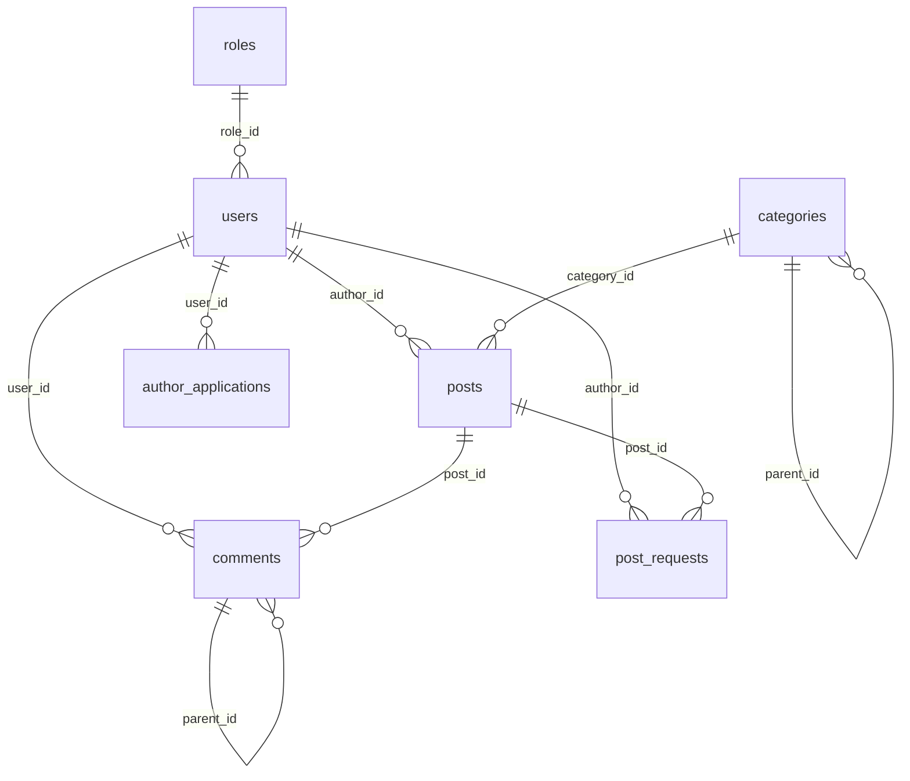

# 📰 NEWSHUB — HỆ THỐNG TÒA SOẠN BÁO ĐIỆN TỬ & MẠNG XUẤT BẢN NỘI DUNG SỐ

[](https://laravel.com)
[](https://php.net)
[](https://tailwindcss.com)
[-success?style=for-the-badge&logo=phpunit&logoColor=white)](tests/)
[](https://laravel.com/docs/pint)
[](LICENSE)

---

## 🌟 1. GIỚI THIỆU TỔNG QUAN

**NewsHub** là hệ thống báo điện tử và mạng quản trị xuất bản nội dung số chuyên nghiệp, được xây dựng trên nền tảng **Laravel 12** và **Tailwind CSS v4**. Dự án mô phỏng quy trình tác nghiệp khép kín của một tòa soạn báo chí hiện đại: từ khâu độc giả nộp hồ sơ ứng tuyển tác giả, phóng viên soạn bài và nộp duyệt, ban biên tập thẩm định xuất bản, đến tiếp nhận phản hồi và kiểm duyệt bình luận đa cấp.

### 🎯 Điểm nhấn kỹ thuật & trải nghiệm người dùng:
- 🖋️ **Ngôn ngữ thiết kế Editorial / Neo-Brutalist:** 
  - Phối màu chuẩn báo chí hiện đại: Nền giấy trắng sạch (`#FFFFFF` / `#F8FAFC`), màu chữ mực in than đen (`#0F172A`), đường viền sắc nét (`border-ink`), đổ bóng hình học thô (`shadow-[2px_2px_0px_#0F172A]`) và màu nhấn thương hiệu Royal Blue (`#1D4ED8`).
  - Hệ thống Typography tối ưu tiếng Việt: Kết hợp **Be Vietnam Pro** (Modern Sans-serif cho giao diện điều hướng, nhãn, nút bấm, dashboard, email) và **Merriweather** (Editorial Serif cho logo nhận diện, tiêu đề bài viết và nội dung bài báo).
- 🧭 **Điều hướng chuyên mục 2 cấp thông minh:**
  - Cấu trúc chuyên mục Cha - Con (Parent - Child) linh hoạt.
  - Thanh trượt danh mục con (Subcategory Slider) hỗ trợ phím điều hướng `>` và `<` khi danh mục dài, đi kèm hiệu ứng làm mờ biên và tự động cuộn đến danh mục đang kích hoạt.
- 🎙️ **Bộ tiện ích đọc báo đa năng:**
  - **Đọc bài bằng giọng nói tự nhiên (Text-to-Speech - TTS):** Sử dụng trực tiếp Web Speech Synthesis API của trình duyệt, hỗ trợ đọc tiếng Việt không cần API bên ngoài.
  - **Tùy chỉnh cỡ chữ đọc báo (A- / A / A+):** Tăng giảm cỡ chữ tức thời giúp người lớn tuổi dễ đọc.
  - **Chế độ in ấn chuyên biệt (Print CSS):** Tự động ẩn thanh điều hướng, footer, nút tương tác khi in hoặc xuất file PDF bài viết sạch đẹp.
  - **Chia sẻ mạng xã hội nhanh:** Hỗ trợ chia sẻ 1 chạm lên Facebook, X (Twitter), Zalo và nút sao chép liên kết kèm thông báo nhanh.
  - **Dữ liệu có cấu trúc SEO:** Tích hợp thẻ JSON-LD Schema `NewsArticle` chuẩn khuyến nghị của Google Tin tức.
  - **Kênh phân phối tin tức:** Cung cấp nguồn cấp tin **RSS 2.0** (`/feed`, `/feed/{category}`) và **Sitemap XML** (`/sitemap.xml`) tự động.
- 🔄 **Quy trình xuất bản chuẩn tòa soạn (Editorial Workflow):** 
  - Tác giả: Soạn thảo ➔ Lưu nháp ➔ Xem trước (`/preview/posts/{id}`) ➔ Nộp duyệt ➔ Rút bài về sửa nếu cần.
  - Ban biên tập: Thẩm định bài viết ➔ Phê duyệt xuất bản hoặc Từ chối kèm ghi chú lý do rõ ràng.
  - Xử lý bài đã xuất bản: Tác giả có thể gửi yêu cầu xin mở khóa chỉnh sửa (`edit_published`) hoặc xin gỡ bài (`unpublish`) kèm lý do; Ban biên tập xét duyệt trực tiếp.
- 💼 **Quy trình ứng tuyển tác giả trực tuyến:** Độc giả nộp hồ sơ gồm giới thiệu bản thân và tệp CV (PDF/DOCX) để Quản trị viên duyệt và tự động nâng cấp vai trò thành Tác giả.
- 💬 **Hệ thống bình luận đa cấp (Nested Comments):** Hỗ trợ độc giả trao đổi, phản hồi bình luận lồng nhau; độc giả có trang quản lý bình luận của chính mình (`/my-comments`); Quản trị viên có bảng điều duyệt và xuất dữ liệu bình luận ra CSV.
- ⚠️ **Xác thực biểu mẫu trực quan (Smart Client-side Validation):** Loại bỏ hoàn toàn bong bóng HTML5 mặc định thô kệch, hiển thị cảnh báo lỗi bằng tiếng Việt ngay dưới từng ô nhập liệu và tự động làm sạch khi người dùng sửa lỗi.
- ✉️ **Email giao dịch đồng bộ thương hiệu:** Mẫu email gửi liên kết kích hoạt tài khoản và đặt lại mật khẩu được thiết kế đồng bộ với nhận diện NewsHub.

---

## 🛠️ 2. CÔNG NGHỆ SỬ DỤNG (TECH STACK)

### 🎨 Frontend (Giao diện & Tương tác người dùng)
- **Blade Template Engine:** Công cụ kết xuất giao diện mặc định của Laravel, tổ chức theo cấu trúc kế thừa và phân tách component rõ ràng (`x-post-card`, `x-comment-item`, layout độc giả `layouts.app` và layout quản trị `layouts.dashboard`).
- **Tailwind CSS v4 (`@tailwindcss/vite` & `tailwindcss` v4.0):** Framework CSS tiện ích thế hệ mới nhất, tích hợp trực tiếp qua Vite giúp tối ưu kích thước bundle và tốc độ biên dịch.
- **Vite 8 (`vite` & `laravel-vite-plugin`):** Hệ thống build công cụ frontend hiện đại với tính năng Hot Module Replacement (HMR).
- **Vanilla JavaScript (ES6+):** Xử lý tương tác micro-UI nhanh, nhẹ, độc lập và không phụ thuộc thư viện cồng kềnh:
  - Thanh trượt chuyên mục mượt mà (Horizontal Subcategory Slider với nút điều hướng và tự động canh giữa mục đang chọn).
  - Trình đọc tin bài bằng giọng nói tự nhiên thông qua **Web Speech Synthesis API**.
  - Tùy chỉnh phóng to / thu nhỏ cỡ chữ (A- / A / A+) và chế độ in ấn báo chí (`@media print`).
  - Hệ thống xác thực biểu mẫu thông minh (Inline Form Validation) và cơ chế chống gửi biểu mẫu trùng lặp (Double-submit guard).
- **Quill Editor 2.0 (Snow Theme):** Trình soạn thảo văn bản phong phú (WYSIWYG) tích hợp trong màn hình viết bài của Tác giả, hỗ trợ định dạng tiêu đề, danh sách, trích dẫn báo chí và kéo thả tải ảnh trực tiếp.
- **Google Fonts (Chuẩn hóa hiển thị tiếng Việt):**
  - **Be Vietnam Pro:** Phông chữ Sans-serif hiện đại dành cho hệ thống điều hướng, nhãn thông số, nút bấm, bảng điều khiển và email giao dịch.
  - **Merriweather:** Phông chữ Editorial Serif cổ điển chuẩn báo chí dành cho Logo thương hiệu, tiêu đề bài viết và nội dung bài báo.

---

### ⚙️ Backend (Nền tảng & Xử lý nghiệp vụ)
- **Ngôn ngữ:** **PHP 8.4 / 8.5** (hỗ trợ Constructor Property Promotion, Type Declarations, Match Expression, Enums).
- **Khung ứng dụng:** **Laravel Framework 12.x / 13.x**:
  - **Eloquent ORM:** Quản lý và thao tác dữ liệu thông qua 7 Models, tối ưu hóa truy vấn bằng Eager Loading tránh lỗi N+1.
  - **Kiến trúc hướng dịch vụ (Service Layer):** Tách biệt nghiệp vụ phức tạp khỏi Controller qua các Service độc lập (`PostWorkflowService`, `AuthorApplicationService`, `UserAccessService`, `CommentModerationService`, `CommentThreadService`, `DashboardStatsService`, `PostModerationService`, `PostRequestService`).
  - **Xác thực dữ liệu (Form Requests):** Tách biệt 100% logic kiểm tra hợp lệ dữ liệu đầu vào (`app/Http/Requests`).
  - **Phân quyền tài nguyên (Resource Policies & Middleware):** Kiểm soát phân quyền chi tiết theo từng bản ghi (`PostPolicy`, `UserPolicy`, `CommentPolicy`) và phân quyền vai trò (`RoleMiddleware`, `EnsureUserIsActive`).
  - **Trạng thái nghiệp vụ (PHP Enums):** Chuẩn hóa tập giá trị với các Enum có định kiểu (`UserRole`, `PostStatus`, `UserStatus`, `PostModerationAction`).
  - **Email & Thông báo (Laravel Mail / Notifications):** Hệ thống thông báo gửi email xác thực tài khoản và liên kết đặt lại mật khẩu với giao diện HTML tùy biến chuyên nghiệp.
- **Xử lý hình ảnh (Image Processing):** Thư viện `intervention/image v4.3` kết hợp extension `ext-gd` để xử lý upload, tự động tạo tên file an toàn, định kích thước và tối ưu hóa ảnh đại diện bài viết.
- **Hệ quản trị cơ sở dữ liệu (Database Support):**
  - **SQLite (Mặc định):** CSDL dạng file nhẹ, không cần cài đặt máy chủ CSDL, tối ưu cho việc khởi chạy nhanh và chạy automated tests.
  - **MySQL / MariaDB:** Hỗ trợ đầy đủ cho môi trường máy chủ / localhost (XAMPP, Laragon) kèm migration và file dump CSDL chuẩn [`database/sql/apptintuc_mysql.sql`](database/sql/apptintuc_mysql.sql).

---

### 🧪 Testing & Công cụ phát triển (Dev & QA)
- **PHPUnit 12.x:** Bộ kiểm thử tự động toàn diện (150 tests, 577 assertions, 100% Passed).
- **Laravel Pint:** Công cụ chuẩn hóa định dạng mã nguồn PHP theo chuẩn PSR-12 và tiêu chuẩn Laravel.
- **FakerPHP:** Khởi tạo dữ liệu giả lập cho Factory và Seeder kiểm thử.
- **Mockery:** Mock đối tượng trong các bài kiểm thử đơn vị độc lập.
- **Laravel Boost, Pail & Pao:** Bộ công cụ hỗ trợ gỡ lỗi và quản trị quá trình phát triển.

---

## 👥 3. HỆ THỐNG PHÂN QUYỀN (RBAC)

Hệ thống được tổ chức với 3 vai trò người dùng lưu trong bảng `roles` kết nối khóa ngoại đến `users`:

```
[Khách vãng lai] ──(Đăng ký & Xác thực Email)──> [Độc giả (User)]
                                                         │
                                                 (Ứng tuyển Tác giả)
                                                         │
                                                         ▼
[Ban biên tập (Admin)] ◄──────(Xét duyệt)──────── [Tác giả (Author)]
```

### Bảng ma trận chức năng theo vai trò:

| Chức năng & Quyền hạn | Khách (Guest) | Độc giả (User) | Tác giả (Author) | Quản trị (Admin) |
| :--- | :---: | :---: | :---: | :---: |
| Xem trang chủ, danh sách tin, chi tiết bài viết | ✅ | ✅ | ✅ | ✅ |
| Lọc tin theo chuyên mục 2 cấp (Cha - Con) & Thanh trượt danh mục | ✅ | ✅ | ✅ | ✅ |
| Tìm kiếm bài viết theo từ khóa & Lọc tin (Mới nhất, Xem nhiều) | ✅ | ✅ | ✅ | ✅ |
| Nghe đọc bài bằng giọng nói (TTS), chỉnh cỡ chữ (A-/A+), in bài (Print) | ✅ | ✅ | ✅ | ✅ |
| Chia sẻ mạng xã hội (Facebook, X, Zalo, Copy Link) | ✅ | ✅ | ✅ | ✅ |
| Xem nguồn cấp tin RSS Feed (`/feed`) & Sơ đồ trang (`/sitemap.xml`) | ✅ | ✅ | ✅ | ✅ |
| Xem trang hồ sơ công khai của tác giả (`/authors/{user}`) | ✅ | ✅ | ✅ | ✅ |
| Đăng ký, đăng nhập tài khoản & Nhận email xác thực | ✅ | ➖ | ➖ | ➖ |
| Quên mật khẩu & Đặt lại mật khẩu qua email | ✅ | ➖ | ➖ | ➖ |
| Gửi biểu mẫu liên hệ tòa soạn (`/lien-he`) | ✅ | ✅ | ✅ | ✅ |
| Đăng bình luận & Trả lời bình luận lồng nhau (Nested Comments) | ❌ | ✅ | ✅ | ✅ |
| Xem, chỉnh sửa và xóa bình luận của chính mình (`/my-comments`) | ❌ | ✅ | ✅ | ✅ |
| Cập nhật hồ sơ cá nhân (Họ tên, Email, Tiểu sử) & Đổi mật khẩu | ❌ | ✅ | ✅ | ✅ |
| Nộp đơn ứng tuyển làm Tác giả kèm tệp CV (`/author-applications`) | ❌ | ✅ | ➖ | ➖ |
| Không gian làm việc Tác giả: Bảng điều khiển thống kê sản lượng cá nhân | ❌ | ❌ | ✅ | ✅ |
| Soạn bài viết mới (Tiêu đề, tóm tắt, nội dung rich-text, tải ảnh inline) | ❌ | ❌ | ✅ | ✅ |
| Lưu bài nháp, nộp bài chờ duyệt, rút bài về bổ sung | ❌ | ❌ | ✅ | ➖ |
| Xem trước bài viết trước khi xuất bản (`/preview/posts/{post}`) | ❌ | ❌ | ✅ | ✅ |
| Gửi yêu cầu xin sửa bài hoặc xin gỡ bài viết đã xuất bản | ❌ | ❌ | ✅ | ➖ |
| Không gian Quản trị: Thống kê tổng thể hoạt động toàn trang | ❌ | ❌ | ❌ | ✅ |
| Tòa soạn kiểm duyệt: Phê duyệt bài viết xuất bản hoặc Từ chối kèm lý do | ❌ | ❌ | ❌ | ✅ |
| Xử lý yêu cầu xin sửa/gỡ bài viết đã xuất bản của tác giả | ❌ | ❌ | ❌ | ✅ |
| Quản lý bài viết toàn trang (Đổi trạng thái, xuất dữ liệu CSV) | ❌ | ❌ | ❌ | ✅ |
| Quản lý chuyên mục 2 cấp: Thêm, sửa, xóa, sắp xếp thứ tự, bật/tắt | ❌ | ❌ | ❌ | ✅ |
| Quản lý người dùng: Phân quyền vai trò, khóa / mở khóa tài khoản | ❌ | ❌ | ❌ | ✅ |
| Gửi liên kết đặt lại mật khẩu an toàn đến email người dùng | ❌ | ❌ | ❌ | ✅ |
| Thẩm định đơn ứng tuyển Tác giả: Tải CV, phê duyệt nâng quyền hoặc từ chối | ❌ | ❌ | ❌ | ✅ |
| Quản lý & kiểm duyệt bình luận toàn trang, ẩn/xóa bình luận & xuất CSV | ❌ | ❌ | ❌ | ✅ |

---

## 🏗️ 4. KIẾN TRÚC HỆ THỐNG & CƠ SỞ DỮ LIỆU

### Mô hình kiến trúc phần mềm:
Dự án áp dụng mô hình **MVC** mở rộng theo đúng chuẩn của hệ sinh thái Laravel:
- **Controllers:** Tách biệt rõ ràng theo từng phân quyền (`Admin\`, `Author\`, `Auth\`, `Public`).
- **Form Requests:** Tách biệt hoàn toàn logic xác thực dữ liệu đầu vào (`app/Http/Requests`).
- **Services:** Đóng gói các nghiệp vụ cốt lõi (`PostWorkflowService`, `AuthorApplicationService`, `UserAccessService`, `MediaService`).
- **Resource Policies:** Phân quyền chặt chẽ trên từng Model (`PostPolicy`, `UserPolicy`, `CommentPolicy`, `PostRequestPolicy`).
- **View Composers:** Tự động nạp dữ liệu chuyên mục cho Header và Sidebar navigation.

### Sơ đồ quan hệ thực thể (ERD):
Cơ sở dữ liệu gồm 7 thực thể chính với các mối quan hệ rõ ràng:



### Danh sách 7 Eloquent Models:
1. **`Role`**: Quản lý vai trò người dùng trong hệ thống (`user`, `author`, `admin`).
2. **`User`**: Tài khoản người dùng, thông tin cá nhân, trạng thái kích hoạt, liên kết vai trò.
3. **`Category`**: Chuyên mục tin tức phân cấp 2 tầng (chuyên mục cha và chuyên mục con), thứ tự sắp xếp và trạng thái hiển thị.
4. **`Post`**: Bài viết tin tức với đầy đủ vòng đời trạng thái (`draft`, `pending`, `published`, `rejected`), ảnh thumbnail, số lượt xem, thời gian xuất bản.
5. **`Comment`**: Bình luận bài viết với quan hệ phân cấp lồng nhau (trả lời bình luận cha qua `parent_id`), trạng thái duyệt.
6. **`AuthorApplication`**: Hồ sơ đăng ký trở thành tác giả của bạn đọc, gồm thông tin giới thiệu, tệp CV đính kèm và kết quả xét duyệt của ban biên tập.
7. **`PostRequest`**: Yêu cầu xin chỉnh sửa hoặc xin gỡ bài viết đã xuất bản từ tác giả gửi lên quản trị viên.

---

## 💻 5. HƯỚNG DẪN CÀI ĐẶT & KHỞI CHẠY DỰ ÁN

### Yêu cầu môi trường:
- **PHP**: `>= 8.4` (hoặc `PHP 8.5`)
- **Composer**: `>= 2.7`
- **Node.js**: `>= 20.x` & **npm**: `>= 10.x`
- Extension PHP cần thiết: `pdo_sqlite` (nếu dùng SQLite) hoặc `pdo_mysql` (nếu dùng MySQL), `fileinfo`, `mbstring`, `openssl`, `curl`.

---

### ⚡ Cách 1: Khởi chạy với SQLite (Nhanh nhất - Không cần cấu hình server CSDL)

Dự án đã tích hợp sẵn cơ sở dữ liệu SQLite trong thư mục `database/`:

```bash
# 1. Cài đặt các thư viện PHP
composer install

# 2. Tạo file cấu hình môi trường từ mẫu
copy .env.example .env

# 3. Tạo khóa ứng dụng
php artisan key:generate

# 4. Tạo liên kết lưu trữ tệp tin tải lên (ảnh bài viết, CV ứng tuyển)
php artisan storage:link

# 5. Chạy migration và khởi tạo dữ liệu mẫu hoàn chỉnh
php artisan migrate --seed

# 6. Cài đặt các thư viện Frontend và biên dịch tài nguyên
npm install
npm run build

# 7. Khởi chạy máy chủ nội bộ
php artisan serve
```

👉 Mở trình duyệt và truy cập: **`http://localhost:8000`**

---

### 🐬 Cách 2: Khởi chạy với MySQL (XAMPP / Laragon)

1. **Khởi động dịch vụ MySQL** trong XAMPP hoặc Laragon.
2. **Tạo database:** Tạo một cơ sở dữ liệu mới có tên `apptintuc` (bảng mã `utf8mb4_unicode_ci`).
3. **Cập nhật file `.env`:**
   ```env
   DB_CONNECTION=mysql
   DB_HOST=127.0.0.1
   DB_PORT=3306
   DB_DATABASE=apptintuc
   DB_USERNAME=root
   DB_PASSWORD=
   ```
4. **Nạp dữ liệu vào MySQL:**
   - *Cách A (Khuyên dùng):* Chạy lệnh Artisan để tự động tạo bảng và nạp seed dữ liệu mẫu:
     ```bash
     php artisan migrate:fresh --seed
     ```
   - *Cách B (Dùng file SQL có sẵn):* Import trực tiếp file SQL đã được trích xuất sẵn tại [`database/sql/apptintuc_mysql.sql`](database/sql/apptintuc_mysql.sql) vào phpMyAdmin.
5. **Biên dịch Frontend và khởi chạy server:**
   ```bash
   npm run build
   php artisan serve
   ```

---

## 🔑 6. TÀI KHOẢN ĐĂNG NHẬP MẪU

Dữ liệu mẫu (`DemoContentSeeder`) đã khởi tạo sẵn 3 tài khoản đại diện cho 3 phân quyền. Tất cả tài khoản đều đã kích hoạt email sẵn:

👉 **Mật khẩu chung:** **`password`**

| Phân quyền (Role) | Tên người dùng | Email đăng nhập | Mật khẩu | Chức năng trải nghiệm chính |
| :--- | :--- | :--- | :--- | :--- |
| **Quản trị viên (Admin)** | Quản trị viên Demo | `admin@newshub.test` | `password` | Quản trị toàn hệ thống, duyệt bài viết phóng viên gửi lên, duyệt đơn ứng tuyển CTV kèm xem CV, quản lý bài viết/chuyên mục/người dùng/bình luận, xuất file CSV. |
| **Tác giả (Author)** | Tác giả Demo | `author@newshub.test` | `password` | Không gian làm việc tác giả, viết bài mới, tải ảnh nội dung, nộp bài chờ duyệt, rút bài, xem trước bài, gửi yêu cầu xin sửa/gỡ bài đã xuất bản. |
| **Độc giả (Reader/User)** | Độc giả Demo | `reader@newshub.test` | `password` | Đọc tin tức, bình luận bài viết, trả lời bình luận lồng nhau, quản lý bình luận cá nhân, nộp đơn ứng tuyển làm Tác giả kèm tệp CV. |

---

## 🧪 7. KIỂM THỬ TỰ ĐỘNG & CHẤT LƯỢNG MÃ NGUỒN

Toàn bộ logic nghiệp vụ, bảo mật và phân quyền của dự án được bao phủ chặt chẽ bởi bộ kiểm thử tự động toàn diện viết bằng **PHPUnit**:

- **Tổng số bài test:** **150 tests**
- **Tổng số assertions:** **577 assertions**
- **Trạng thái:** **100% Passed**
- **Định dạng mã nguồn:** Tuân thủ chuẩn PSR-12 và chuẩn Laravel thông qua **Laravel Pint**.

```bash
# Chạy toàn bộ bộ test
php artisan test --compact

# Tự động chuẩn hóa định dạng mã nguồn PHP
vendor/bin/pint --format agent
```

---

## 📁 8. CẤU TRÚC THƯ MỤC DỰ ÁN

```text
PhpProject/
├── app/
│   ├── Enums/                  # Các Enum định nghĩa trạng thái (PostStatus, UserRole, UserStatus, etc.)
│   ├── Http/
│   │   ├── Controllers/        # Bộ điều khiển (Admin, Author, Auth, Public)
│   │   ├── Middleware/         # Kiểm tra phân quyền vai trò (RoleMiddleware, EnsureUserIsActive)
│   │   ├── Requests/           # Các lớp Form Request xác thực dữ liệu đầu vào
│   │   └── ViewComposers/      # Tự động nạp danh mục cho Header và Sidebar
│   ├── Models/                 # 7 Eloquent Models ánh xạ CSDL
│   ├── Notifications/          # Các thông báo Email (Xác thực tài khoản, Đặt lại mật khẩu)
│   ├── Policies/               # Chính sách phân quyền tài nguyên (PostPolicy, UserPolicy, etc.)
│   └── Services/               # Tầng xử lý logic nghiệp vụ độc lập (Workflow, Application, Media)
├── bootstrap/                  # Cấu hình khởi động ứng dụng (app.php chuẩn Laravel 12)
├── config/                     # Cấu hình hệ thống (auth, database, mail, filesystems, etc.)
├── database/
│   ├── database.sqlite         # File CSDL SQLite nhúng sẵn dữ liệu mẫu
│   ├── factories/              # Factory sinh dữ liệu giả cho testing
│   ├── migrations/             # Lược đồ cơ sở dữ liệu
│   ├── seeders/                # Bộ Seeder khởi tạo dữ liệu mẫu hoàn chỉnh
│   └── sql/                    # Bản xuất CSDL chuẩn MySQL (apptintuc_mysql.sql)
├── public/                     # Thư mục gốc web server
├── resources/
│   ├── css/                    # Cấu hình Tailwind CSS v4, phông chữ và tùy chỉnh giao diện
│   ├── js/                     # Scripts tương tác micro-UI (Smart Validation, Slider, Audio TTS)
│   └── views/                  # Toàn bộ Blade Views theo phong cách Editorial
├── routes/                     # Định nghĩa hệ thống URL (web.php, console.php)
├── storage/                    # Thư mục lưu trữ tệp tải lên (ảnh, CV), logs và framework cache
└── tests/                      # Bộ kiểm thử tự động 150 Feature & Unit Tests
```

---

## 📄 9. BẢN QUYỀN & GIẤY PHÉP

Dự án được phát hành theo giấy phép mã nguồn mở **[MIT License](LICENSE)**. Toàn bộ mã nguồn phục vụ mục đích học tập, nghiên cứu và phát triển phần mềm.
